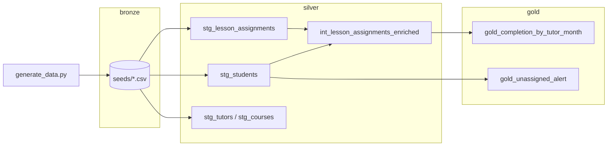

# Learning Analytics with dbt

[](https://github.com/paulrodriguezd/learning-analytics-dbt/actions/workflows/dbt-build.yml)

A small, runnable analytics engineering project on synthetic data from a fictional online
learning platform. It builds a **bronze → silver → gold** pipeline in Postgres with dbt,
computes a **completion rate per tutor** with an explicit metric definition, and raises a
**data quality alert** when new students arrive without a tutor.

The point is not the size of the data but how the pipeline is built: every metric states its
population, time window and denominator, the edge cases are covered by unit tests, and the
data generator plants real problems so the checks have something to catch.

All data is invented and generated by [`scripts/generate_data.py`](scripts/generate_data.py) with a fixed seed.

## Quick start

Requirements: Docker and Python 3.10–3.12.

```bash
docker compose up -d --wait
python -m venv .venv && source .venv/bin/activate
pip install -r requirements.txt
export DBT_PROFILES_DIR=.
dbt build
```

Expected result: `PASS=35 WARN=1 ERROR=0`. The warning is the data quality alert firing for
November and December 2025, where the generator injects an onboarding bug on purpose.

Stop the database with `docker compose down -v`.

## Pipeline



| Layer | Schema | What it holds | Materialized as |
|---|---|---|---|
| Bronze | `bronze` | Raw CSVs loaded as-is with `dbt seed`. | tables |
| Silver | `silver` | Typed, cleaned and joined data. Deleted students are flagged, not dropped. | views |
| Gold | `gold` | Business metric and data quality alert. | tables |

## Metric: completion rate per tutor and month

| | Definition |
|---|---|
| **Unit** | One lesson assigned to one student. |
| **Population** | Lessons of students that exist, are not deleted and have a tutor. |
| **Completed** | Finished within 7 days of being assigned (`completion_window_days`). A completion dated before the assignment does not count. |
| **Denominator** | Lessons whose 7-day window had fully passed by the extraction date (`as_of_date`). Lessons assigned in the last days are left out instead of being counted as not completed. |
| **Aggregation** | Completed / assigned over the whole tutor-month (ratio of totals), so a student with 30 lessons weighs more than one with 2. |

Result on the synthetic data: 11,947 lessons over 20 tutors, overall rate **71.4%**,
ranging from 53% to 90% per tutor across the year.

## Data quality alert: students without a tutor

Share of new active students without a tutor, by signup month. It warns (without failing the
build) when the share is above 5% (`unassigned_alert_share`). It is computed from the students
table itself, so a lesson whose student is missing or deleted can never be miscounted as
"no tutor".

| Signup month | New students | Without tutor | Share | Alert |
|---|---:|---:|---:|:---:|
| 2025-01 … 2025-10 | 99–134 per month | 0–4 | 0.0%–3.5% | – |
| **2025-11** | 92 | 16 | **17.4%** | ⚠️ |
| **2025-12** | 134 | 32 | **23.9%** | ⚠️ |

## Tests

| Type | What it checks |
|---|---|
| Data tests | Unique and not-null keys, relationships between students, tutors, courses and lessons. |
| Unit tests | Ratio of totals (9/10 = 0.9, not the mean of 0.5 and 1.0); both edges of the 7-day window and of `as_of_date`; deleted students ignored; a share exactly at the threshold does not alert. |
| Singular tests | Completion rate within [0, 1]; the unassigned-student alert (severity `warn`). |

CI runs `dbt build` against a fresh Postgres on every pull request.

## Configuration

Parameters live in [`dbt_project.yml`](dbt_project.yml) and can be overridden at run time:

```bash
dbt build --vars '{completion_window_days: 14, unassigned_alert_share: 0.10}'
```

## Known limitations

- `tutor_id` is the student's **current** tutor; tutor history is not modelled.
- Timestamps have no time zone and are assumed to be UTC.
- With a 2% normal level and ~120 new students a month, a month can cross the 5% threshold by
  chance. With seed 42 the alert only fires during the simulated bug; with another seed it may not.

## Project structure

```text
.
├── scripts/generate_data.py   # synthetic data generator (seed 42)
├── seeds/                     # bronze: generated raw CSVs
├── models/
│   ├── silver/                # staging + intermediate views
│   └── gold/                  # metric and alert tables, unit tests
├── tests/                     # singular tests
├── macros/                    # plain schema names (bronze/silver/gold)
├── docker-compose.yml         # local Postgres on 127.0.0.1:55432
└── profiles.yml               # dbt connection (local throwaway credentials)
```

## License

[MIT](LICENSE)
